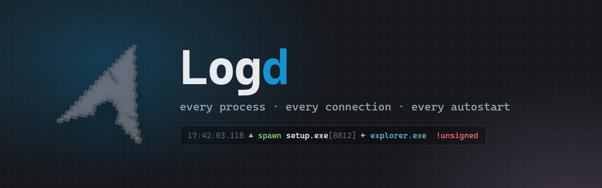
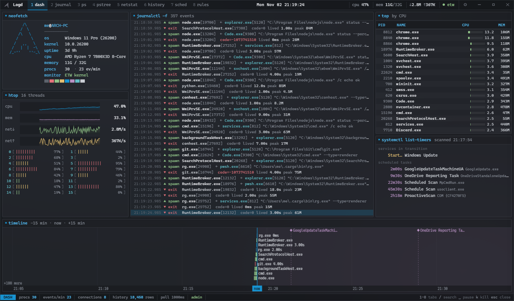
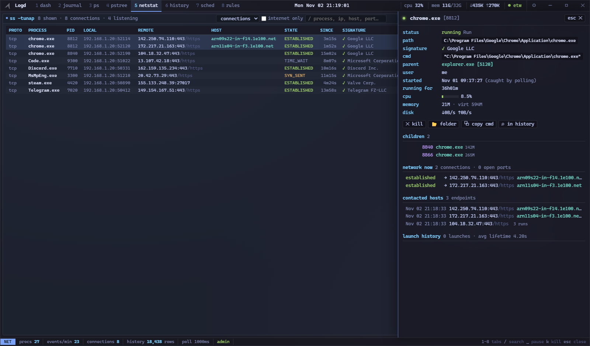
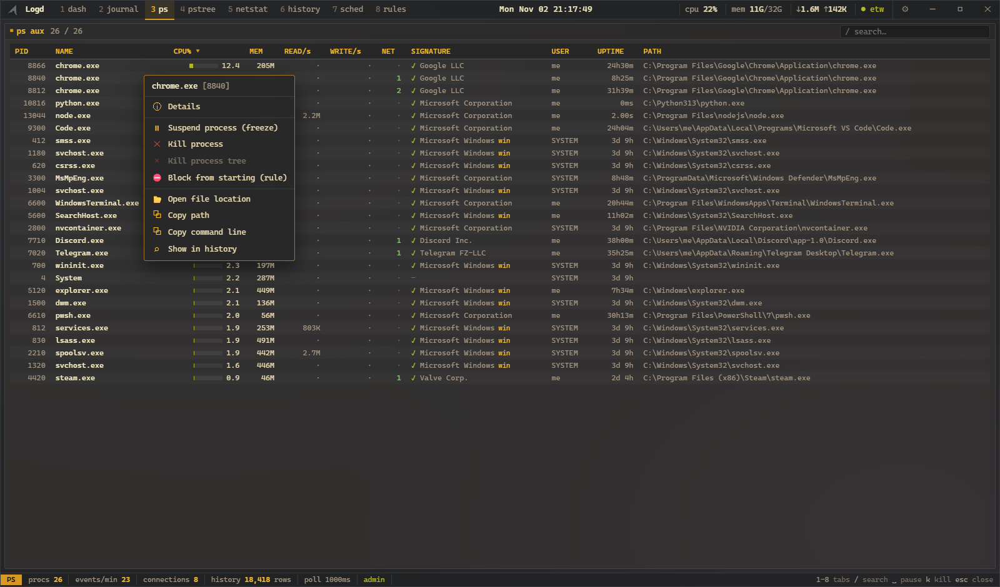
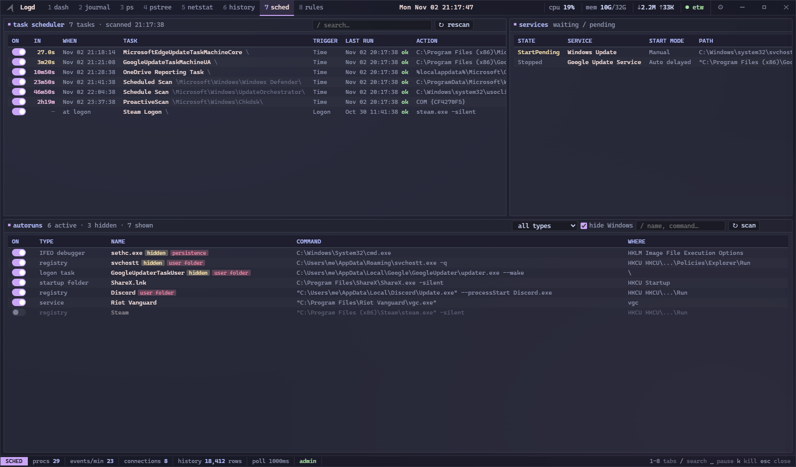
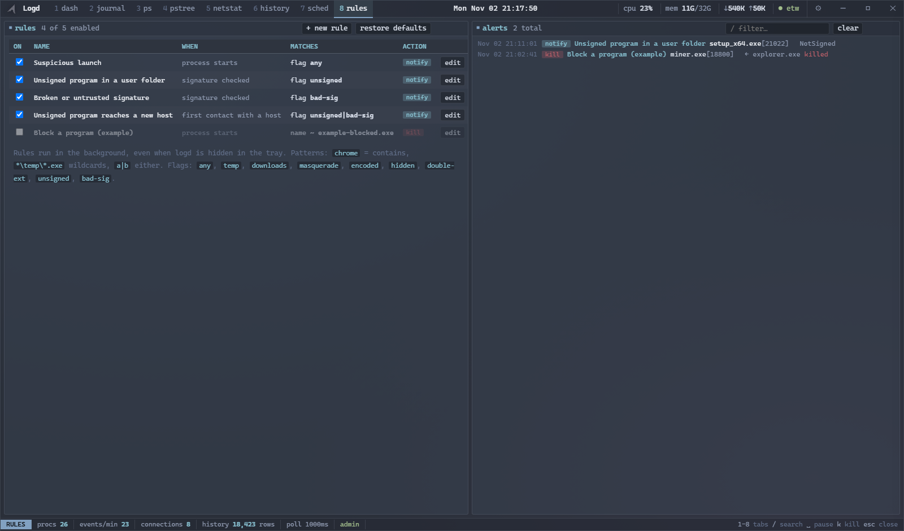

<p align="center">
  
</p>

<p align="center">
  <b>A live process, network and autostart monitor for Windows.</b><br>
  Tiling-WM look, six themes, one ~5&nbsp;MB portable executable.
</p>

<p align="center">
  <a href="../../releases"></a>
</p>

<p align="center">
  
  
  
  
  
  <a href="LICENSE"></a>
</p>

<p align="center">
  
</p>

---

Logd watches everything that runs on your PC: processes as they start and exit, what is already running,
what is scheduled to start next, which programs talk to the internet and which ones start with Windows.
Everything is recorded locally, so you can scroll back in time.

## Features

**Live monitoring**
- `journal` — a `journalctl -f` style feed of every spawn and exit, with parent, command line, lifetime, exit code and peak memory
- `ps` / `pstree` — running processes with CPU, memory, disk I/O, network connections and digital signature
- `dash` — everything on one screen: system info, per-core load, live feed, top processes, upcoming tasks and a timeline from 15 min ago to 15 min ahead
- ETW kernel tracing when run as administrator: catches processes that live only milliseconds and records exact exit codes

**Network** (`netstat`)
- every TCP/UDP socket per process, reverse-DNS host names, open ports
- "first contacts": the first time a program talks to a host it has never contacted before
- per-program history of every endpoint it ever reached

**Security**
- Authenticode signature check for every executable (catalog-signed Windows files included)
- heuristic flags: launched from Temp/Downloads, system names outside `C:\Windows`, encoded PowerShell, `.pdf.exe` style double extensions, unsigned binaries in user folders, broken signatures
- **rules** that run in the background even when the window is hidden: match a spawn, a new network contact or a signature verdict, then notify, log or kill
- right-click any process: suspend (freeze) / resume, kill, kill the whole tree, block it from starting, disable its autostart

**Autostart** (`sched`)
- upcoming scheduled tasks with countdowns, pending services
- every autostart entry, including places Task Manager does not show: RunOnce, policy Run keys, legacy `Load`, Winlogon `Shell`/`Userinit`, IFEO debuggers, AppInit DLLs, WMI subscriptions
- disable / re-enable each entry; anything Logd changes in the registry or a service is backed up first so it can be restored

**History**
- SQLite history of every process lifetime, network endpoint and load sample, with a searchable timeline and CSV export
- configurable retention; the database is integrity-checked at startup and repaired if damaged

**Interface**
- dockable panels: drag the gutters to resize, drag a title onto another panel to dock or swap, Shift-drag to float, double-click to maximize
- six themes — Arch, Nord, Gruvbox, Catppuccin Mocha, Tokyo Night, Dracula — and adjustable window transparency
- Windows notifications, tray icon, start with Windows (optionally elevated for ETW)

Keyboard: `1`–`8` tabs · `/` search · `space` pause the feed · `k` kill selected · `esc` close / restore

## Screenshots

<table>
  <tr>
    <td width="50%"><br><sub><b>netstat</b> — every connection with host names and signatures, plus the full story of a process · <i>Tokyo Night</i></sub></td>
    <td width="50%"><br><sub><b>ps</b> — right-click to suspend, kill a whole tree or block a program from starting · <i>Gruvbox</i></sub></td>
  </tr>
  <tr>
    <td width="50%"><br><sub><b>sched</b> — upcoming tasks and every autostart, hidden ones included, each with an on/off switch · <i>Catppuccin Mocha</i></sub></td>
    <td width="50%"><br><sub><b>rules</b> — background rules that notify, log or kill, with an alert journal · <i>Nord</i></sub></td>
  </tr>
</table>

<sub>Screenshots show the built-in demo data (<code>npm run preview</code>), not a real machine.</sub>

## Download

Grab `logd.exe` from [Releases](../../releases). It is a single portable executable; WebView2 (built into Windows 10/11) is required.

> **Smart App Control:** the executable is not code-signed, so Windows Smart App Control (if enabled) will block it.

Run it normally for polling mode, or as administrator for ETW tracing and to change system-wide autostart entries.

## Build from source

Requirements: [Rust](https://rustup.rs) (MSVC toolchain), [Node.js](https://nodejs.org) 18+, Visual Studio Build Tools with the C++ workload.

```bash
npm install
npm run build
```

The executable is written to `src-tauri/target/release/logd.exe`.

```bash
npm run dev       # run with hot reload of the UI
npm run preview   # open the UI in a browser with mock data (no Rust needed)
```

If the build fails with `LNK1104` on a deeply nested folder, Windows path length is the cause: point Cargo at a short target directory in `src-tauri/.cargo/config.toml`:

```toml
[build]
target-dir = "C:/logd-target"
```

## Project layout

```
src-tauri/src/
  main.rs       app setup, commands, tray
  monitor.rs    process polling, lifetime tracking, snapshots
  etw.rs        kernel process events (administrator)
  net.rs        TCP/UDP tables per process, reverse DNS
  sigs.rs       Authenticode verification and cache
  rules.rs      rule engine and alerts
  autoruns.rs   autostart scan, disable / restore
  sched.rs      scheduled tasks and pending services
  os.rs         notifications, start with Windows
  db.rs         SQLite history
ui/
  index.html, style.css, app.js   the interface (no framework, no bundler)
  layout.js                       dockable panel layout
  mock.js                         fake backend for `npm run preview`
```

## Privacy

Logd has no telemetry and makes no network requests of its own except reverse-DNS lookups for addresses your programs connect to.
History is stored in `%APPDATA%\dev.logd.app\history.db`.

## License

[MIT](LICENSE). The Arch Linux logo is a trademark of the Arch Linux project; Logd is not affiliated with Arch Linux.
